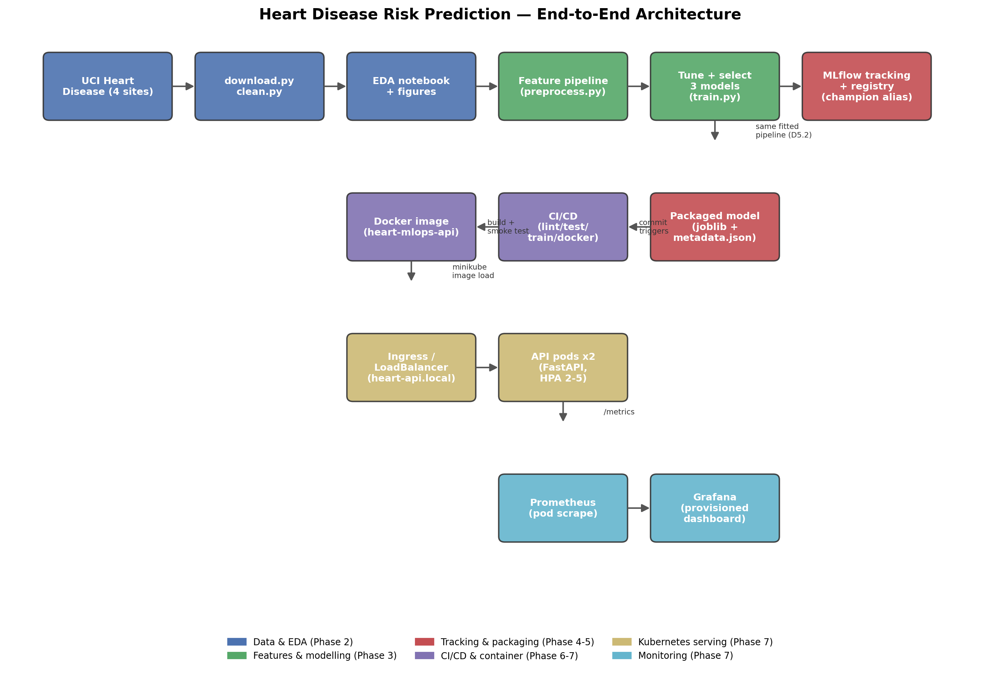

# Heart Disease Risk Prediction — End-to-End MLOps

An end-to-end MLOps pipeline for predicting the presence of heart disease from
patient health attributes: data acquisition and EDA, feature engineering and
model development, experiment tracking, packaging, CI/CD, containerisation,
Kubernetes deployment, and monitoring.

Dataset: the combined four-site UCI Heart Disease dataset (Cleveland,
Hungarian, Switzerland, VA Long Beach; ~920 rows), which brings real
site-dependent missingness and distribution shift rather than the smaller,
cleaner 303-row Cleveland-only subset usually seen. See
[`data/README.md`](data/README.md) for provenance and the column dictionary
(populated in Phase 2).

**Status:** all nine phases are done — data/EDA, modelling, experiment
tracking, packaging, CI/CD, containerisation, Kubernetes deployment and
monitoring, lab-parity verification, and this documentation pass. The full
written report is [`reports/MLOps_Assignment1_Report.docx`](reports/MLOps_Assignment1_Report.docx).



See [`docs/ARCHITECTURE.md`](docs/ARCHITECTURE.md) for the walk-through, or
[`SETUP_GUIDE.md`](SETUP_GUIDE.md) for a complete, copy-pasteable, step-by-step
walkthrough of every command in this project from a fresh clone onward.

## Repository map

```
src/heart_mlops/   Python package: data, features, models, api
notebooks/         EDA / modelling / inference-demo notebooks
scripts/           check_env, setup_venv, train, mlflow_ui, build_image,
                   run_container_smoke, k8s_deploy, k8s_verify, load_test, k8s_teardown
                   -- bash equivalents of make targets
test/              pytest unit + API tests
docker/            Dockerfile + docker-compose.yml
k8s/               Kustomize manifests (base / monitoring / overlays/minikube)
monitoring/        Prometheus + Grafana config (provisioned, not click-ops)
models/            Trained model artefact + metadata + model card
reports/           Generated figures + the DOCX report
docs/              Design decisions, architecture, video script
```

## Prerequisites

- Python **3.13.x** on macOS (dev) / **3.12.x** on Linux (BITS Prayogshala lab)
- git, curl, make
- Docker
- minikube **v1.35.0** and kubectl (a missing `kubectl` falls back to
  `minikube kubectl --` everywhere)

Run the preflight check first, on either OS:

```bash
bash scripts/check_env.sh
```

It reports versions of every tool above, CPU/RAM, and whether ports
8000 (API) / 5001 (MLflow UI) / 9090 (Prometheus) / 3000 (Grafana) are free.
It exits non-zero only if a hard requirement (python3, pip, git, curl) is
missing; everything else is reported as a warning so you can decide how to
proceed. Port 5000 is deliberately avoided for MLflow because it's used by
AirPlay Receiver on macOS.

## Quick start

```bash
bash scripts/check_env.sh      # or: make check-env
bash scripts/setup_venv.sh     # or: make venv
source .venv/bin/activate
```

`scripts/setup_venv.sh` picks the Python version pinned for your OS (3.13.x on
macOS, 3.12.x on Linux) rather than trusting whatever `python3` happens to
resolve to on `$PATH` — see [`docs/DECISIONS.md`](docs/DECISIONS.md#d03--scriptssetup_venvsh-does-not-blindly-trust-python3-on-path)
for why. It then installs `requirements-dev.txt` (a superset of
`requirements.txt`) and prints `pip list`.

## Data, training, and experiment tracking

```bash
make data        # downloads the 4 UCI site files (checksum-verified) and cleans them into
                 # data/processed/heart_combined_clean.csv
make train       # tunes all 3 models, selects one by the pre-registered rule in
                 # docs/DECISIONS.md D3.1, logs everything to MLflow, registers the
                 # champion -- or: bash scripts/train.sh (also runs `make data` first
                 # if the cleaned CSV isn't present yet)
make mlflow-ui   # serves the MLflow UI at http://127.0.0.1:5001 -- or: bash scripts/mlflow_ui.sh
```

Each training run creates one MLflow parent run ("training-session") with
one nested child run per model (hyperparameters, CV + hold-out metrics,
`cv_results.csv`, classification report, confusion matrix); the selected
model's child run additionally gets a feature-importance plot and the
logged model itself (with signature + input example). The parent run also
gets the model comparison table, ROC/PR/calibration plots, and the model
card. The selected model is registered under
`heart_disease_classifier` and aliased `champion` -- not MLflow's
deprecated Staging/Production *stages* (see
[`docs/DECISIONS.md`](docs/DECISIONS.md) D4.2) -- so serving code should
always resolve it as `models:/heart_disease_classifier@champion`, never by
a hardcoded version number. Both the backend store (`mlflow.db`) and
artifacts (`mlartifacts/`) are local and gitignored by default;
`MLFLOW_TRACKING_URI` overrides this without code changes.

## Model packaging

`make train` also writes `models/heart_model.joblib` (the full
preprocessing + classifier pipeline) and `models/model_metadata.json`
(model name, registry version, threshold, feature schema, hold-out
metrics, training data checksum, sklearn version, git SHA, timestamp).
These are the *same* fitted pipeline just registered in MLflow, saved a
second time in a serving-friendly format — the API (Phase 7) loads this
pair directly rather than depending on an MLflow server being reachable at
serving time (`docs/DECISIONS.md` D5.1/D5.2). Both files are small enough
to commit, so `docker build` works on a fresh clone without retraining.
See [`models/MODEL_CARD.md`](models/MODEL_CARD.md) for intended use,
limitations, and per-site performance.

`test/test_reproducibility.py` checks that re-fitting the packaged model's
exact hyperparameters on the same data twice gives matching predictions
(`pytest test/test_reproducibility.py`) — a fast determinism check, not a
re-run of the full tuning search (`docs/DECISIONS.md` D5.3).

## API

```bash
.venv/bin/uvicorn heart_mlops.api.main:app --reload --port 8000
```

Loads `models/heart_model.joblib` + `model_metadata.json` directly (no
MLflow server needed at serving time — `docs/DECISIONS.md` D5.1).

| Endpoint | Purpose |
|---|---|
| `GET /health` | Liveness — always `200` once the process is up |
| `GET /ready` | Readiness — `200` once the model artifact has loaded, else `503` |
| `GET /model-info` | Model name/version/threshold/feature schema/metrics |
| `POST /predict` | `prediction`, `label`, `confidence`, `risk_probability`, `threshold`, `model_version`, `request_id` |
| `POST /predict/batch` | Same, for up to 100 records in one request (`{"records": [...]}` → `{"predictions": [...]}`) |
| `GET /metrics` | Prometheus exposition format |
| `GET /docs` | Auto-generated OpenAPI docs with field-level examples |

All 13 `PatientFeatures` fields are required, with evidence-based clinical
range validation (`docs/DECISIONS.md` D6.2) — out-of-range values or a
missing field return `422`, not a 500 or a silent bad prediction. Request
logs are structured JSON (request id, path, status, latency, predicted
class, model version) and **never include the raw patient feature
values** (`docs/DECISIONS.md` D6.4). Sample requests for manual testing
are in [`test/sample_requests/`](test/sample_requests/).

```bash
curl http://127.0.0.1:8000/health

curl -X POST http://127.0.0.1:8000/predict \
  -H "Content-Type: application/json" \
  -d @test/sample_requests/valid_high_risk.json

curl -X POST http://127.0.0.1:8000/predict/batch \
  -H "Content-Type: application/json" \
  -d '{"records": [
        '"$(cat test/sample_requests/valid_high_risk.json)"',
        '"$(cat test/sample_requests/valid_low_risk.json)"'
      ]}'
```

Two env vars let ops adjust behaviour without a rebuild: `LOG_LEVEL`
(passed straight to the logger) and `PREDICTION_THRESHOLD` (overrides the
packaged model's threshold at startup; the packaged `model_metadata.json`
value stays the default when unset) — both wired into the Kubernetes
ConfigMap below (`docs/DECISIONS.md` D7.3).

## Containerisation

```bash
make build-image     # builds heart-mlops-api:latest -- or: bash scripts/build_image.sh
make docker-smoke     # builds + runs + waits for health + checks every
                      # test/sample_requests/*.json against its expected
                      # status, saves the log to screenshots/logs/
make compose-up       # API + Prometheus + Grafana locally, non-k8s
make compose-down
```

`docker/Dockerfile`: multi-stage, `python:3.12.9-slim` (matches the lab),
`--platform linux/amd64`, runs as a non-root user, only runtime
dependencies (`requirements.txt`, not `-dev`), a `HEALTHCHECK` using
stdlib `urllib` (no `curl` in the image), a configurable worker count
(`UVICORN_WORKERS`), and OCI labels carrying the real version and git SHA.

## Kubernetes deployment and monitoring

```bash
make k8s-deploy      # starts minikube if needed, enables ingress + metrics-server,
                      # builds the image inside minikube's own Docker daemon,
                      # applies k8s/overlays/minikube, waits for rollout
make k8s-verify       # checks pods/svc/ingress/hpa, then calls /health and
                      # /predict through BOTH the Ingress and the LoadBalancer
make load-test        # small concurrent traffic generator, so Grafana has real data
make k8s-teardown     # removes the app + monitoring stack (leaves minikube running)
```

Manifests are organised with **Kustomize** (`kubectl apply -k`, built into
`kubectl` — no Helm): `k8s/base/` (namespace, ConfigMap, 2-replica
Deployment with liveness/readiness probes and a non-root `securityContext`,
ClusterIP Service, LoadBalancer Service, Ingress at host `heart-api.local`,
and a CPU-based HPA scaling 2→5 replicas) plus `k8s/monitoring/`
(Prometheus with Kubernetes pod-discovery scraping, Grafana with its
datasource and the same dashboard docker-compose uses, both provisioned as
code), composed together by `k8s/overlays/minikube/`.

The Grafana admin password comes from a Secret `k8s_deploy.sh` generates
from `.env`'s `GRAFANA_ADMIN_PASSWORD` — never committed. On macOS,
`k8s_verify.sh` reaches the Ingress and LoadBalancer via
`kubectl port-forward` rather than `minikube tunnel`, because the
Ingress's privileged ports (80/443) need an interactive `sudo` password
that an unattended script can't supply — and the lab disallows `sudo`
entirely anyway (`docs/DECISIONS.md` D7.7). On Linux, `minikube ip` is
directly reachable, so neither tunnel nor port-forward is needed.

## Testing and CI

```bash
make test        # or: .venv/bin/pytest -- JUnit XML + coverage XML/HTML,
                 # fails under 90% coverage (docs/DECISIONS.md D6.5)
make lint        # ruff check + ruff format --check
```

`.github/workflows/ci.yml` runs on every push/PR to `main` plus manual
dispatch: `lint` (ruff), `test` (matrix: Python 3.12.9 and 3.13.5,
mirroring the lab and this Mac exactly), `train` (downloads + cleans fresh
data, falling back to the committed cleaned CSV with a clear warning if
UCI is unreachable; trains; writes a metrics table to the job summary;
uploads the packaged model, metadata, figures, and MLflow run data as
artifacts), and `docker` (builds the image from the repo's committed model
artifact and runs the exact same `scripts/run_container_smoke.sh` a
developer runs locally — gated on `test` rather than `train`, so a slow or
flaky UCI download never blocks the container check; `docs/DECISIONS.md`
D7.8). Pushing the built image to GHCR is not wired up — gated on asking
first, per the brief.

## Running this at the BITS Prayogshala lab

See [`LAB_RUNBOOK.md`](LAB_RUNBOOK.md) for copy-paste steps on the lab
machine — clone through teardown, no `sudo` anywhere, with a troubleshooting
section (resource limits, the `ingress` addon, the `minikube kubectl --`
fallback, port conflicts, proxy settings). Verified by actually doing a
fresh clone and following it literally, step by step, before trusting it
(`docs/DECISIONS.md` D8.2) — not just written and assumed correct.

```bash
make lab-parity   # re-proves the exact pins in requirements*.txt install and
                  # run correctly inside a fresh python:3.12.9-slim container
```

## Reporting

```bash
make report   # regenerates the architecture diagram and the DOCX report
              # from the current figures/metadata -- or: .venv/bin/python reports/build_report.py
```

[`reports/MLOps_Assignment1_Report.docx`](reports/MLOps_Assignment1_Report.docx)
pulls its metrics and tables directly from `models/model_metadata.json`
and the CSVs in `reports/figures/`, and embeds every generated figure —
so it can never drift from what the code actually produced. Any
screenshot listed in
[`screenshots/SCREENSHOT_CHECKLIST.md`](screenshots/SCREENSHOT_CHECKLIST.md)
is embedded automatically once saved at its exact target path; otherwise
the report shows a clearly labelled placeholder instead of guessing.
Rendered and visually checked page-by-page before being called done —
not just generated and assumed correct (`docs/DECISIONS.md` D9.2). See
[`docs/DELIVERABLES.md`](docs/DELIVERABLES.md) for where every required
deliverable lives, and [`docs/VIDEO_SCRIPT.md`](docs/VIDEO_SCRIPT.md) for
the recorded-walkthrough script.

## Design decisions

Every non-obvious choice in this project (dataset, missing-value handling,
Python/minikube version pinning, threshold selection, etc.) is logged with its
rationale and alternatives considered in [`docs/DECISIONS.md`](docs/DECISIONS.md).

## Roadmap

| Phase | Status |
|---|---|
| 0 — Preflight | Done |
| 1 — Repository scaffold | Done |
| 2 — Data acquisition & EDA | Done |
| 3 — Feature engineering & modelling | Done |
| 4 — Experiment tracking (MLflow) | Done |
| 5 — Packaging & reproducibility | Done |
| 6 — CI/CD & automated testing | Done |
| 7 — Containerisation, Kubernetes, monitoring | Done |
| 8 — Lab-parity verification | Done |
| 9 — Documentation & reporting | Done |
